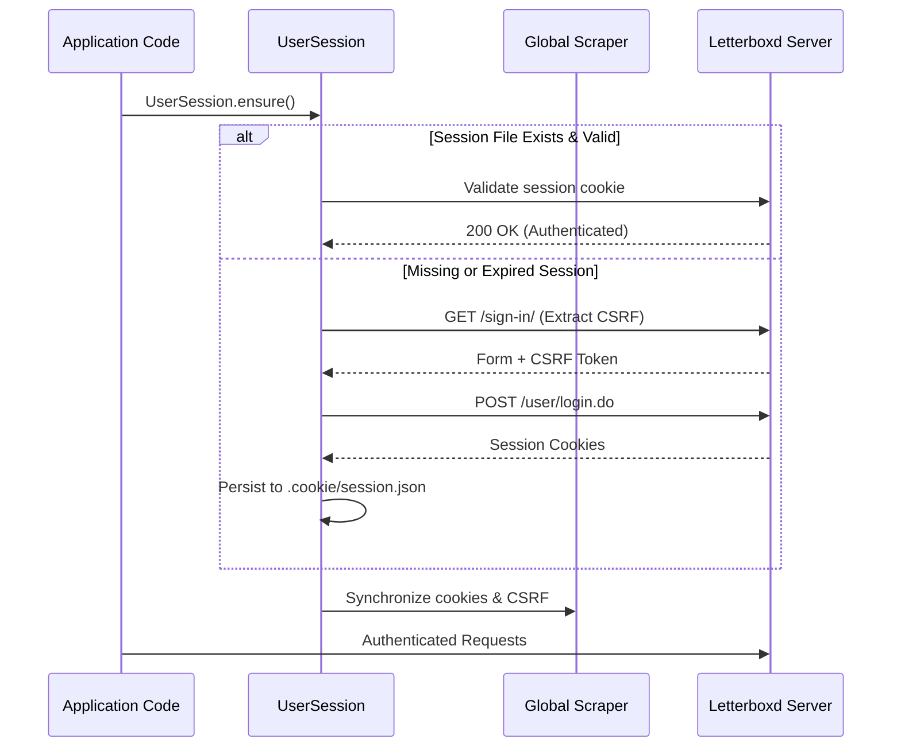

# Authentication & Settings Guide

The `letterboxdpy.auth` and `letterboxdpy.account.settings` modules enable secure authenticated interactions with Letterboxd for managing profile data, personal settings, and private actions.

---

## Session Architecture

`UserSession` is trace-locked: every behavior matches legitimate browser traffic with automated CSRF extraction and token management.

Sessions are stored locally in JSON format at `.cookie/session.json` by default (with strict permissions `chmod 600` on POSIX systems).



---

## Authenticating a Session

### Automatic Session Initialization

Use `UserSession.ensure()` to seamlessly use an existing session or prompt for login interactively if unauthenticated:

```python
from letterboxdpy.auth import UserSession

# Loads existing session or initiates login
session = UserSession.ensure()
print(f"Authenticated as: {session.username}")
```

### Programmatic Login

```python
from letterboxdpy.auth import UserSession

session = UserSession.login("your_username", "your_password")
```

### Loading from Custom Storage

```python
from pathlib import Path
from letterboxdpy.auth import UserSession

session = UserSession.load(Path(".cookie/session.json"))
```

---

## Managing Profile & Settings

Once authenticated, use `UserSettings` to inspect or update account configurations:

```python
from letterboxdpy.auth import UserSession
from letterboxdpy.account.settings import UserSettings

session = UserSession.ensure()
settings = UserSettings(session)

# 1. Fetch current profile
profile = settings.get_profile()
print(f"Bio: {profile.get('bio')}")
print(f"Location: {profile.get('location')}")

# 2. Update profile details
settings.update_profile({
    "location": "New York, USA",
    "website": "https://example.com",
    "bio": "Cinephile and Python enthusiast."
})

# 3. Notification preferences
notifs = settings.get_notifications()
settings.update_notifications({
    "emailEditorial": True,
    "pushFollowers": False
})
```

---

## Security Best Practices

> [!WARNING]
> Keep your `.cookie/` directory private. Never commit session files to version control repositories.
> Ensure `.cookie/` is present in your `.gitignore`.

