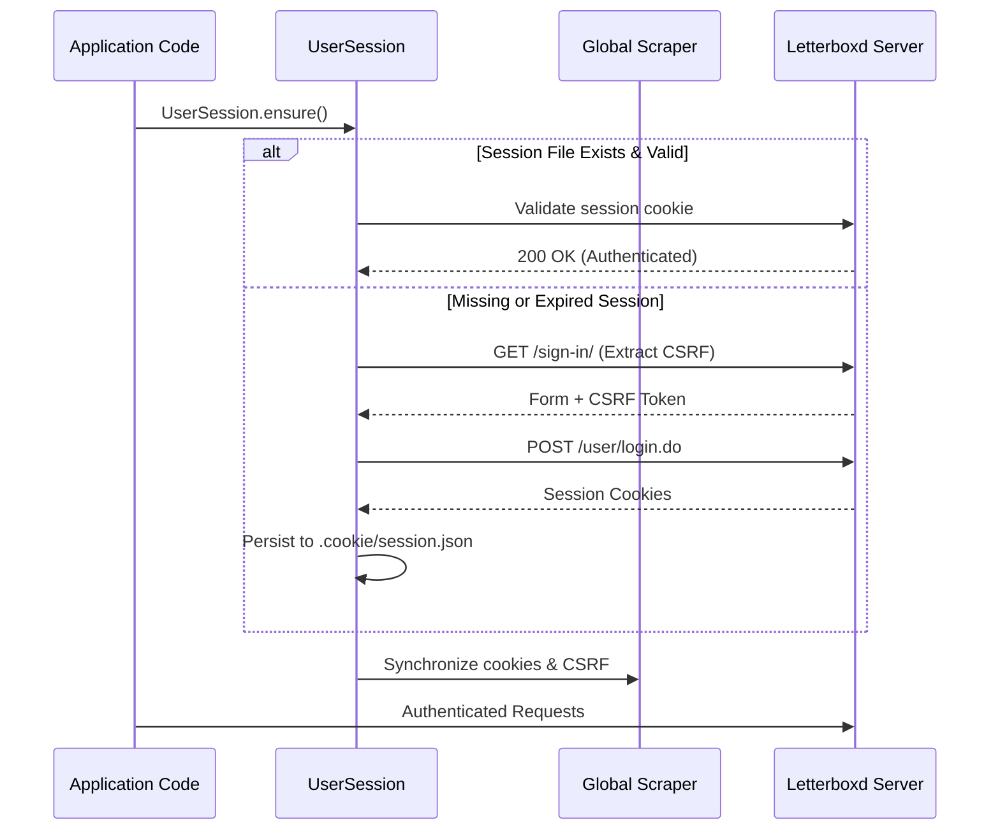

# Authentication & Settings Guide

The `letterboxdpy.auth` and `letterboxdpy.account.settings` modules enable secure authenticated interactions with Letterboxd for managing profile data, personal preferences, and private settings.

---

## Architecture & Security

`UserSession` is trace-locked: every behavior matches legitimate browser traffic with automated CSRF extraction and token management.



> [!WARNING]
> Keep your `.cookie/` directory private. Never commit session files to version control repositories.
> Ensure `.cookie/` is listed in your `.gitignore`. On POSIX systems, `letterboxdpy` automatically enforces `chmod 600`.

---

## Authenticating a Session

### 1. Automatic Session Initialization (Recommended)

`UserSession.ensure()` checks for an existing session file. If absent or expired, it interactively prompts for credentials via the terminal:

```python
from letterboxdpy.auth import UserSession

session = UserSession.ensure()
print(f"Authenticated as: @{session.username}")
```

### 2. Programmatic Login

For automated environments with environment variables:

```python
import os
from letterboxdpy.auth import UserSession

username = os.environ["LETTERBOXD_USER"]
password = os.environ["LETTERBOXD_PASS"]

session = UserSession.login(username, password)
```

### 3. CLI Authentication

You can also authenticate directly from your command line before running scripts:

```bash
python -m letterboxdpy.auth --login
```

---

## Managing Profile & Settings

Once authenticated, use `UserSettings` to inspect or update account configurations:

```python
from letterboxdpy.auth import UserSession
from letterboxdpy.account.settings import UserSettings

session = UserSession.ensure()
settings = UserSettings(session)

# 1. Fetch current profile data
profile = settings.get_profile()
print(f"Given Name: {profile.get('givenName')}")
print(f"Bio: {profile.get('bio')}")
print(f"Location: {profile.get('location')}")
```

??? example "Sample `get_profile()` Response Payload (Mock Demonstration)"

    ```json
    {
      "givenName": "bugra",
      "familyName": "coskun",
      "location": "Istanbul, Turkey",
      "website": "https://bugra.co",
      "bio": "Watching movies and writing code.",
      "favouriteFilms": [
        {"id": "51940", "name": "Three Colours: Red"},
        {"id": "51727", "name": "Once Upon a Time in the West"},
        {"...": "..."}
      ]
    }
    ```

### Updating Profile Information

```python
# Update bio and location
settings.update_profile({
    "location": "Istanbul, Turkey",
    "website": "https://bugra.co",
    "bio": "Watching movies and writing code."
})
```

### Managing Notifications

```python
# Fetch current notification preferences
notifications = settings.get_notifications()

# Toggle specific email/push notifications
settings.update_notifications({
    "emailEditorial": True,
    "pushFollowers": False,
    "emailActivity": False
})
```

---

## Error Handling

Handle authentication exceptions cleanly:

```python
from letterboxdpy.auth import UserSession
from letterboxdpy.core.exceptions import LoginFailedError, MissingCredentialsError

try:
    session = UserSession.login("invalid_user", "wrong_password")
except LoginFailedError as e:
    print(f"Login failed: {e}")
except MissingCredentialsError:
    print("Credentials were not supplied.")
```

---

## API Reference

For detailed function definitions, see:
- [Authentication API Reference](../api/auth.md)
- [Settings API Reference](../api/settings.md)
