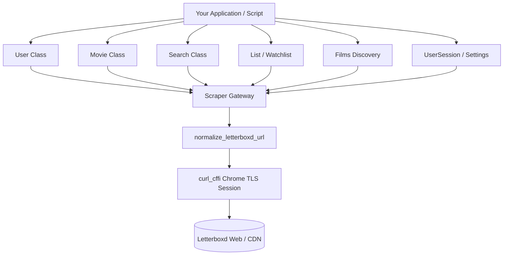

# Welcome to letterboxdpy

A modern, fast, and feature-rich Python library for scraping and interacting with Letterboxd data.

---

## Features

- **Core Letterboxd Entities**: First-class models for `User`, `Movie`, `Search`, `List`, `Watchlist`, and `Members`.
- **WAF & Cloudflare Resilient**: Built on `curl_cffi` using real browser TLS impersonation (`chrome120`) and RFC-compliant URL normalization.
- **Deep User Insights**: Extract complete watchlists, chronological diary entries, user wrapped summaries, ratings, reviews, followers, and genre distribution.
- **Advanced Film Discovery**: Discover films by genre, curated themes, release years, decades, or streaming services.
- **Trace-Locked Sessions**: Authenticated account settings and profile updates via automated CSRF handling.
- **Deterministic & Typed**: Strict type hints, comprehensive offline test suite, and clean snake_case JSON schemas.

---

## Quick Start

### Installation

=== "pip (Recommended)"
    ```bash
    pip install letterboxdpy
    ```

=== "Git (Latest Main)"
    ```bash
    pip install git+https://github.com/nmcassa/letterboxdpy.git
    ```

=== "Editable (Development)"
    ```bash
    git clone https://github.com/nmcassa/letterboxdpy.git
    cd letterboxdpy
    pip install -e ".[dev,docs,examples]"
    ```

---

## Basic Usage

### Fetching a User

=== "Python"
    ```python
    from letterboxdpy.user import User

    # Initialize a user instance
    user = User("bugracoskun")

    print(f"Display Name: {user.display_name}")
    print(f"Badge: {user.badge}")
    print(f"Watchlist Count: {user.watchlist_length}")
    print(f"Watched Films: {user.stats.get('films')}")
    ```

=== "Sample Output"
    ```text
    Display Name: bugra
    Badge: patron
    Watchlist Count: 150
    Watched Films: 500
    ```

### Fetching a Movie

=== "Python"
    ```python
    from letterboxdpy.movie import Movie

    # Initialize by slug, TMDB ID, or IMDb ID
    movie = Movie("v-for-vendetta")

    print(f"Title: {movie.title} ({movie.year})")
    print(f"Rating: {movie.rating} / 5.0")
    print(f"Runtime: {movie.runtime} mins")
    ```

=== "Output"
    ```text
    Title: V for Vendetta (2005)
    Rating: 3.84 / 5.0
    Runtime: 132 mins
    ```

### Searching Letterboxd

=== "Python"
    ```python
    from letterboxdpy.search import Search, SearchFilter

    # Search for films
    search = Search("Inception", search_filter=SearchFilter.FILMS)
    results = search.get_results(3)

    for item in results.get("results", []):
        print(f"{item.get('name')} ({item.get('year')}) -> {item.get('url')}")
    ```

=== "Output"
    ```text
    Inception (2010) -> https://letterboxd.com/film/inception/
    ```

---

## Architecture Overview



---

## Explore the Documentation

| Module Guide | Description | API Reference |
| :--- | :--- | :--- |
| **[Getting Started](getting-started.md)** | Installation, Cloudflare resilience, core classes | - |
| **[User Guide](guides/user.md)** | Profile stats, watched films, diary, wrapped, social | [User API](api/user.md) |
| **[Movie Guide](guides/movie.md)** | Details, cast, crew, reviews, similar movies | [Movie API](api/movie.md) |
| **[Search Guide](guides/search.md)** | Full-text search across 12 categories, slug lookup | [Search API](api/search.md) |
| **[List Guide](guides/list.md)** | User lists, movie collections, tags, descriptions | [List API](api/list.md) |
| **[Watchlist Guide](guides/watchlist.md)** | Saved watchlists, genre/decade/provider filtering | [Watchlist API](api/watchlist.md) |
| **[Films & Discovery](guides/films.md)** | Browse upcoming, genres, themes, streaming services | [Films API](api/films.md) |
| **[Members Guide](guides/members.md)** | Popular profiles, leaderboards, community members | [Members API](api/members.md) |
| **[Authentication](guides/auth.md)** | Sessions, profile updates, notification management | [Auth API](api/auth.md) |
| **[Examples & Tools](examples.md)** | Ready-to-run CLI utilities, export tools, visualizations | - |
| **[Development](development.md)** | Environment setup, pytest, Ruff linting, CI/CD | - |
