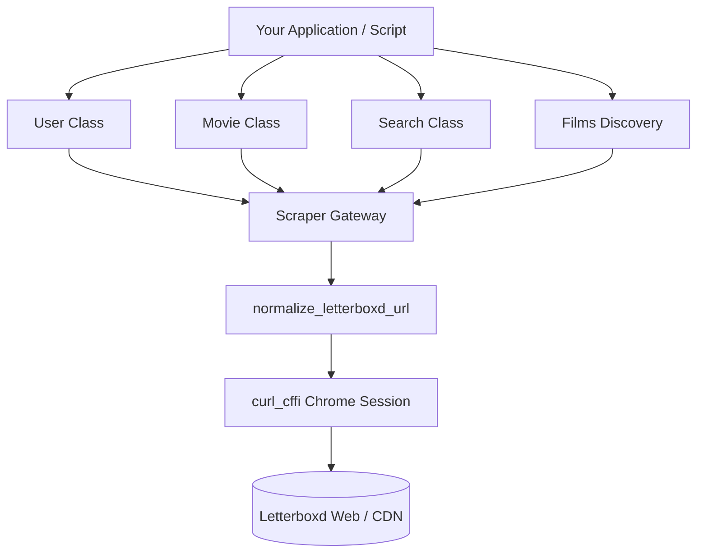

# Welcome to letterboxdpy

A modern, fast, and feature-rich Python library for scraping and interacting with Letterboxd data.

---

## Features

- **Core Letterboxd Entities**: First-class support for `User`, `Movie`, `Search`, `List`, and `Films`.
- **WAF & Cloudflare Resilient**: Built with `curl_cffi` using modern browser impersonation (`chrome120`) and RFC-compliant URL normalization.
- **Deep User Insights**: Extract watchlists, diary logs, likes, reviews, followers, following, and genre distribution.
- **Advanced Film Discovery**: Discover films by genre, sub-genre, themes, release years, decades, or streaming services.
- **Type Annotated & Clean**: Clean, structured return models with consistent snake_case keys and ISO 8601 timestamps.

---

## Quick Start

### Installation

=== "pip (Recommended)"
    ```bash
    pip install letterboxdpy
    ```

=== "Git (Latest Main)"
    ```bash
    pip install git+https://github.com/nmcassa/letterboxdpy.git
    ```

=== "Editable / Development"
    ```bash
    git clone https://github.com/nmcassa/letterboxdpy.git
    cd letterboxdpy
    pip install -e ".[docs,examples]"
    ```

---

## Basic Usage

### Fetching a User

=== "Python"
    ```python
    from letterboxdpy.user import User

    # Initialize a user instance
    user = User("nmcassa")

    print(f"Display Name: {user.display_name}")
    print(f"Watchlist Count: {user.watchlist_length}")
    print(f"Bio: {user.bio}")
    ```

=== "Output"
    ```text
    Display Name: Nicholas Cassarino
    Watchlist Count: 560
    Bio: Film enthusiast & programmer.
    ```

### Fetching a Movie

=== "Python"
    ```python
    from letterboxdpy.movie import Movie

    # Initialize by slug or TMDB/IMDb ID
    movie = Movie("dune-part-two")

    print(f"Title: {movie.title} ({movie.year})")
    print(f"Rating: {movie.rating}")
    print(f"Runtime: {movie.runtime} mins")
    ```

=== "Output"
    ```text
    Title: Dune: Part Two (2024)
    Rating: 4.5
    Runtime: 166 mins
    ```

### Searching Letterboxd

=== "Python"
    ```python
    from letterboxdpy.search import Search, SearchFilter

    # Search for films
    search = Search("Inception", search_filter=SearchFilter.FILMS)
    results = search.results.get("results", [])

    for item in results[:3]:
        print(f"{item.get('name')} ({item.get('year')}) -> {item.get('url')}")
    ```

---

## Architecture Overview



Explore the documentation guides on the left sidebar to dive deep into each component.

